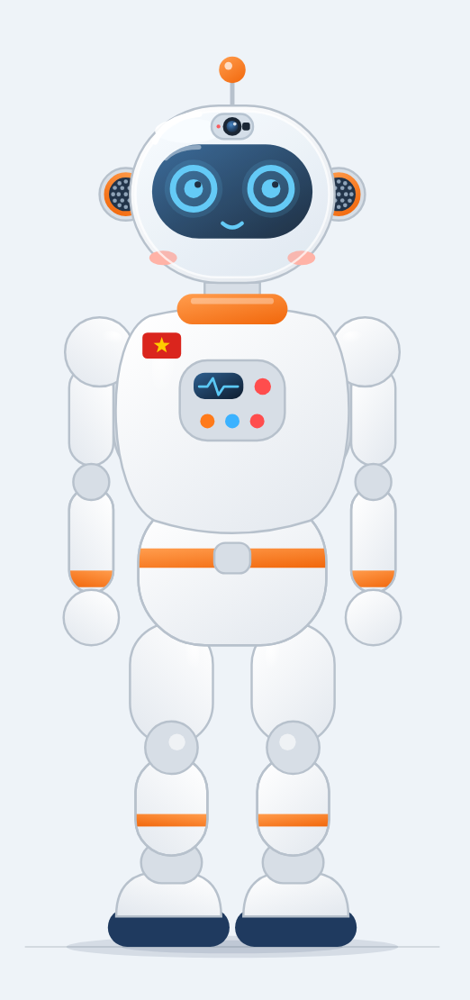
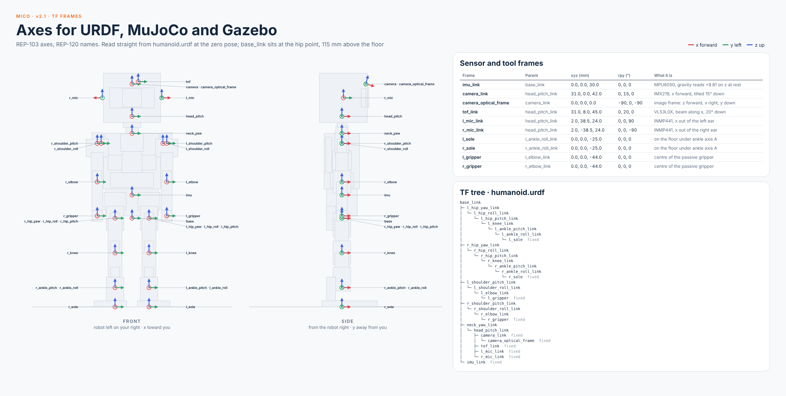

# Synapse Humanoid · Mico


<p align="center">
  
</p>

**Mico** is a 303 mm, 20-DoF bipedal humanoid built from parts sold in Ho Chi Minh City, with a MuJoCo digital twin
and a ROS 2 Jazzy stack. *Cute outside, capable inside. Made in Việt Nam.*

| Height | Mass | DoF | Compute | Sensors | BOM |
| --- | --- | --- | --- | --- | --- |
| 303 mm | 536 g | 20 (legs 2×6, arms 2×3, neck 2) | Radxa Zero 3W (Cortex-A55 + NPU) · STM32F411 (Cortex-M4) | IMU, camera, ToF, 2 mics, 4 foot FSRs | ≈ 5.65M VND |

## TF frames



REP-103 axes (x forward, y left, z up) and REP-120 names. `base_link` sits at the hip point, 115 mm above the floor.
`imu_link` is on the pelvis top plate (z 145 mm) and reads +9.81 m/s² on z at rest. One generator,
[`sim/mini_humanoid/gen_robot.py`](sim/mini_humanoid/gen_robot.py), writes all three models with identical frames:

| File | For |
| --- | --- |
| [`sim/mini_humanoid/humanoid.xml`](sim/mini_humanoid/humanoid.xml) | MuJoCo (MJCF) |
| [`sim/mini_humanoid/humanoid.urdf`](sim/mini_humanoid/humanoid.urdf) | ROS, RViz, Foxglove; MuJoCo also loads it directly |
| [`src/humanoid_description/urdf/mico.urdf.xacro`](src/humanoid_description/urdf/mico.urdf.xacro) | Gazebo Harmonic + `gz_ros2_control` |

`python sim/mini_humanoid/check_urdf.py` compares the URDF with the MJCF over 200 random poses (0.0000 mm error).

## Quickstart

```bash
# MuJoCo digital twin (macOS: use mjpython for the viewer)
pip install mujoco numpy
cd sim/mini_humanoid
python gen_robot.py          # regenerate MJCF, URDF and the Gazebo xacro
mjpython demo.py             # walk 8 steps, turn 60°, wave
python demo.py --check       # headless run with a servo load report
python kin_dyn.py            # DH tables, checked against MuJoCo

# ROS 2 Jazzy (Ubuntu 24.04, or OrbStack on macOS: ./setup_orbstack.sh)
colcon build --symlink-install && source install/setup.bash
ros2 launch humanoid_description mico_gz.launch.py   # Mico in Gazebo with IMU, camera, ToF
```

## Repository

| Path | What |
| --- | --- |
| [`sim/mini_humanoid`](sim/mini_humanoid) | Model generator, MuJoCo demo, DH / dynamics tables, URDF check |
| [`docs/design/sketch_shell_a`](docs/design/sketch_shell_a) | Mico design: shell, skeleton J01–J20, expressions, GA drawing, BOM |
| [`src/humanoid_description`](src/humanoid_description) | URDF / xacro, Gazebo launch, ros2_control config |
| [`src/humanoid_control`](src/humanoid_control) | ros2_control bringup |
| [`src/humanoid_perception`](src/humanoid_perception) | Camera pipeline, ONNX Runtime inference |
| [`src/humanoid_infrastructure`](src/humanoid_infrastructure) | Lock-free SPSC queues, thread pool, shared-memory IPC |
| [`src/humanoid_interfaces`](src/humanoid_interfaces) | Custom ROS 2 messages |

## Roadmap

- [x] 20-DoF model, MuJoCo walk / turn / wave, DH tables, foot FSRs, TF frames
- [x] Mico shell, mechanical skeleton and fit check, BOM at HCMC prices
- [ ] Shell v2.1 from the fit check (arms, head display, hip and heel housings)
- [ ] Footstep planner + closed-form leg IK, then ZMP / LIPM walking
- [ ] STM32 servo firmware and Radxa ROS 2 bringup on the real robot

## License

Apache 2.0, as declared in each package.xml.
