# Mini humanoid sketches (v0.5)

**Main shell: A2 · Mico v2.0 — cute outside, capable inside.** A1's face in Pico's suit, every part a soft
capsule or dome. Perception and expression are separate: the IMX219 camera and a VL53L0X ToF sit behind
their own forehead window, while one 2.42″ OLED behind the visor draws the eyes and mouth. Ears are I2S MEMS
mic grilles, each foot has heel and toe FSRs, the neck sits in an orange collar ring, Vietnam flag on the chest.

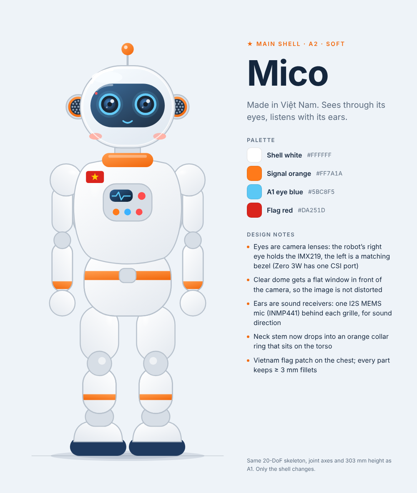

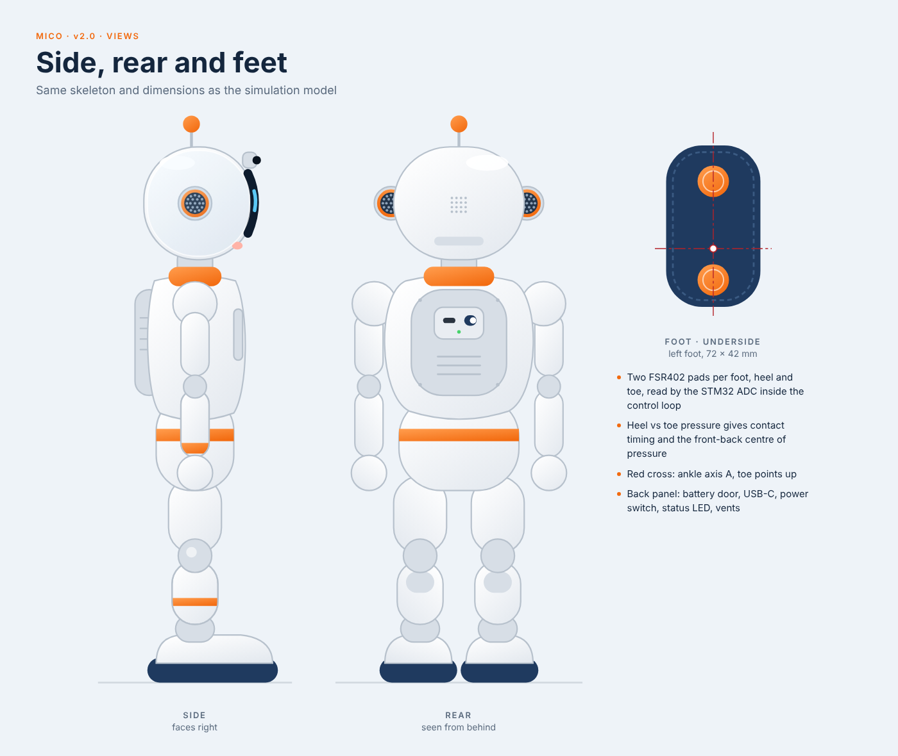

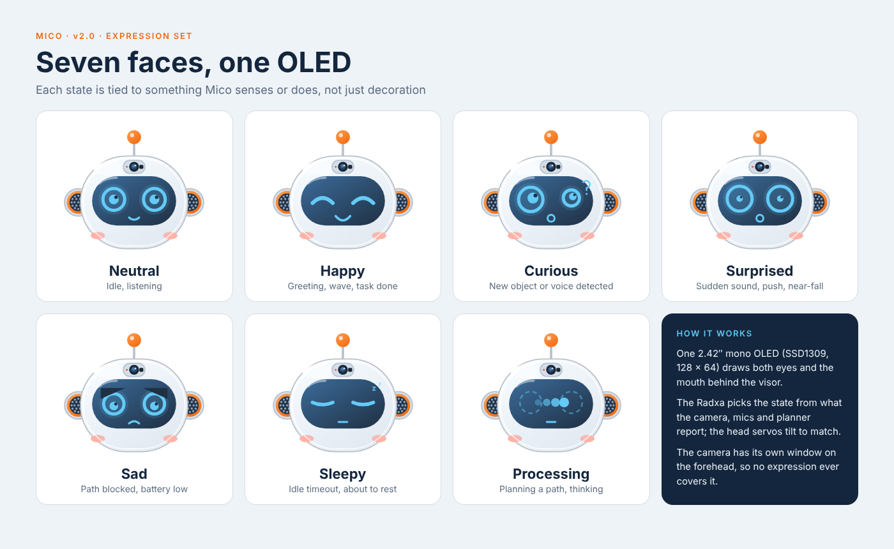

## Hero family

| A1 · Hero | A3 · Pico | A4 · Luno | A5 · Kiko |
| --- | --- | --- | --- |
| 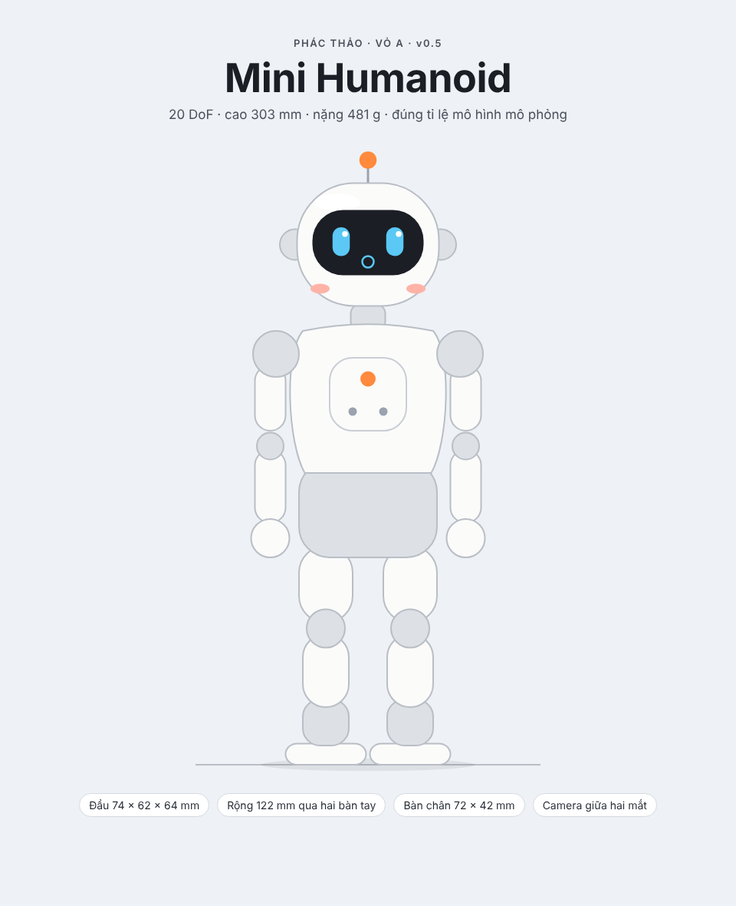 | 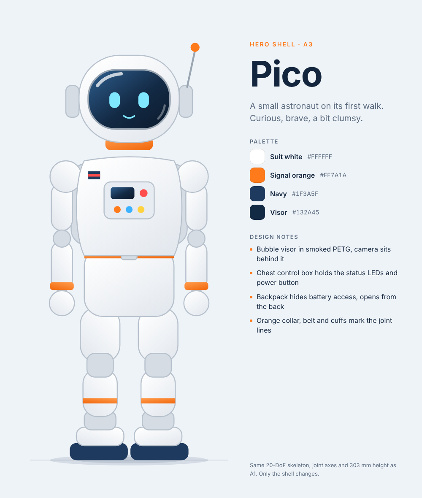 | 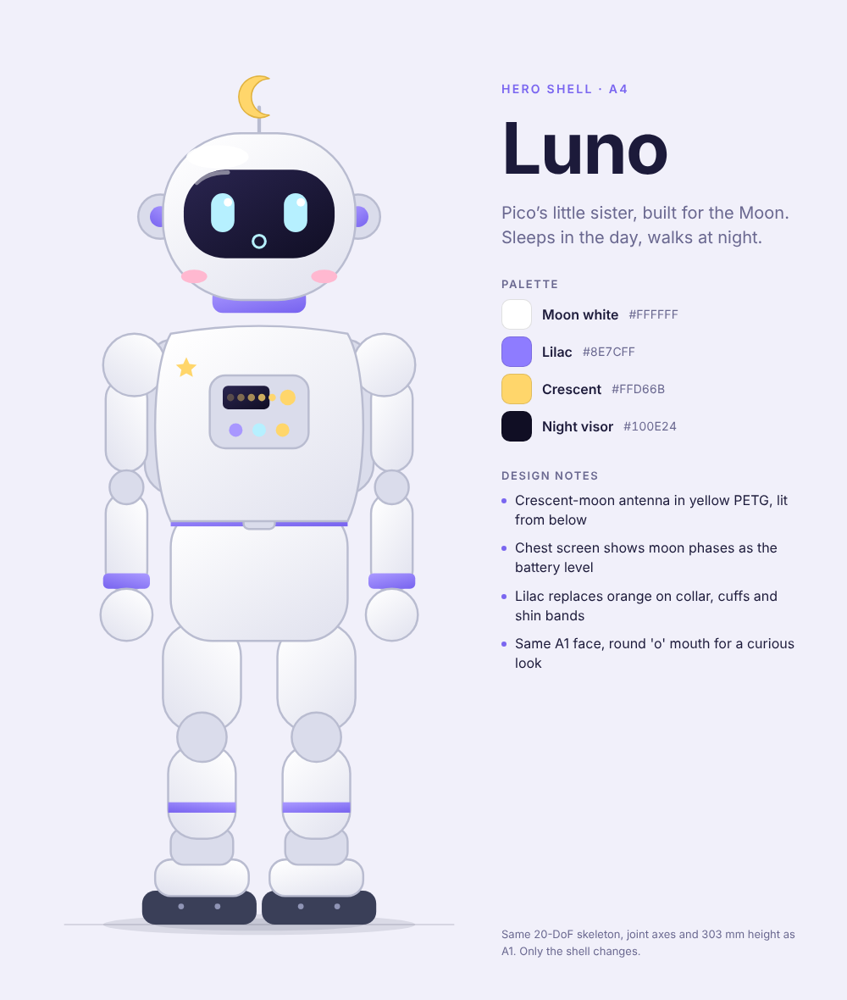 | 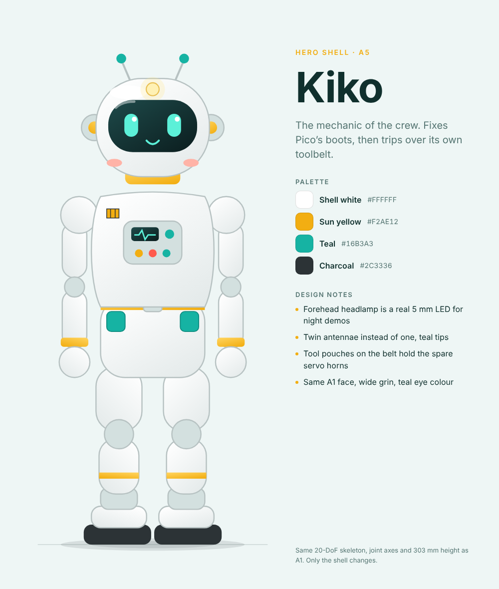 |

All five share the same 20-DoF skeleton, joint axes and 303 mm height; only the shell changes.

## Reference boards

Claude Design canvas source for the 20-DoF mini humanoid. Shell A (cute) is the hero,
shell B (armor) is the villain; both share the same skeleton and joint axes. All geometry is drawn in mm
from the same dimensions as `sim/mini_humanoid/gen_robot.py` (303 mm tall, 481 g).

| Front | Side |
| --- | --- |
|  | 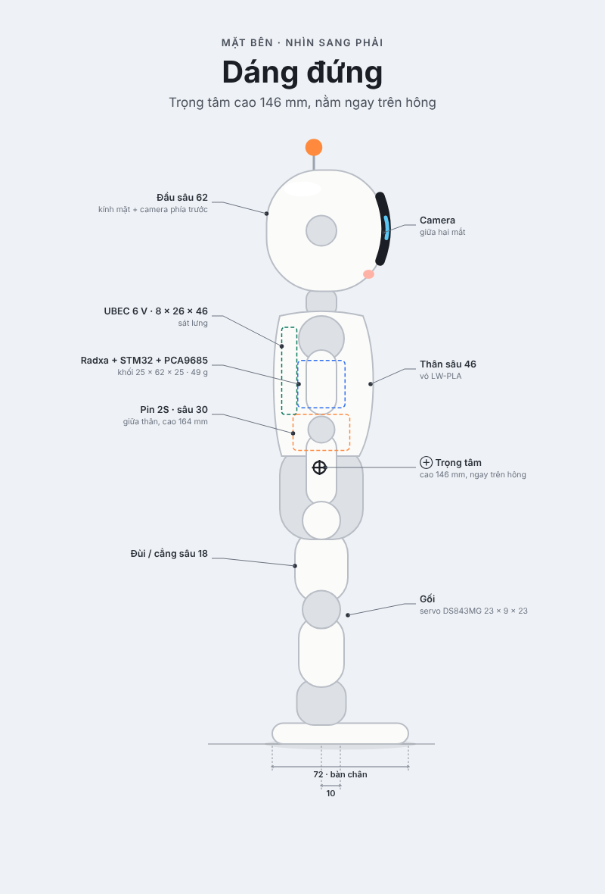 |

### Villain · shell B

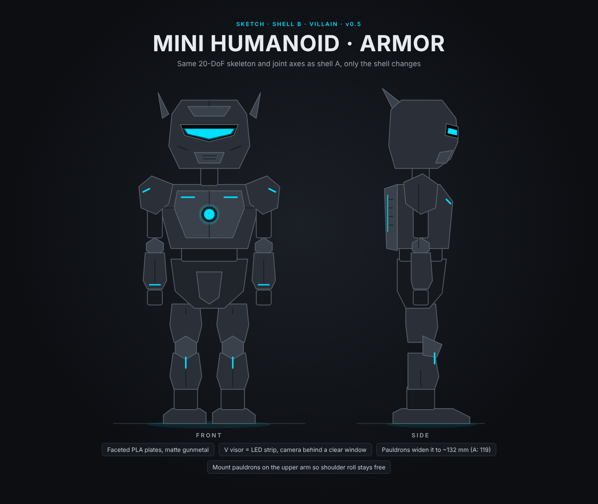

Pauldrons widen it to about 132 mm (A: 119) and must ride on the upper arm so shoulder roll stays free.

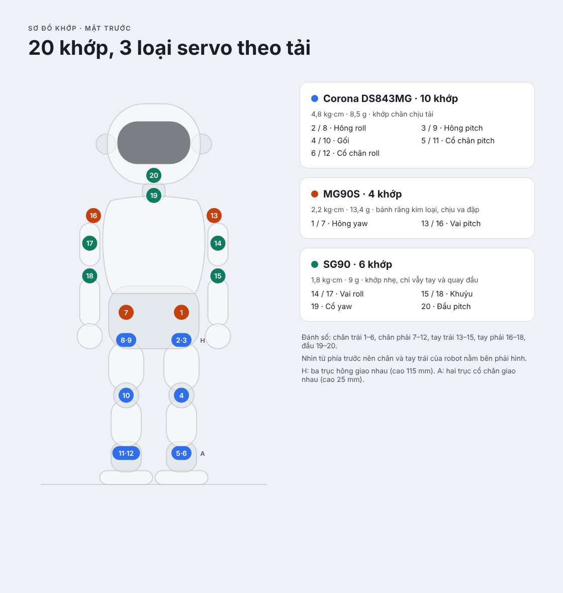

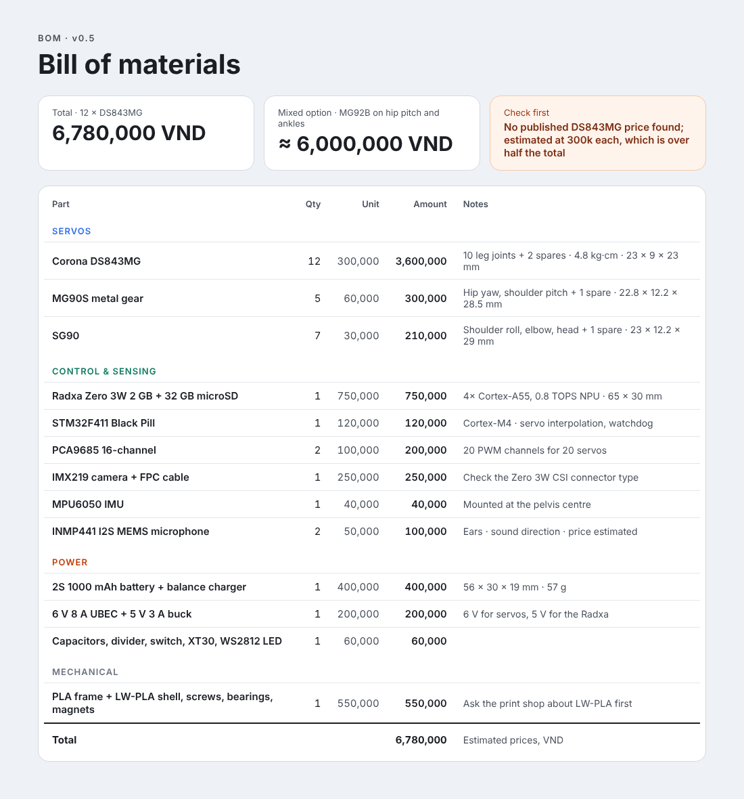

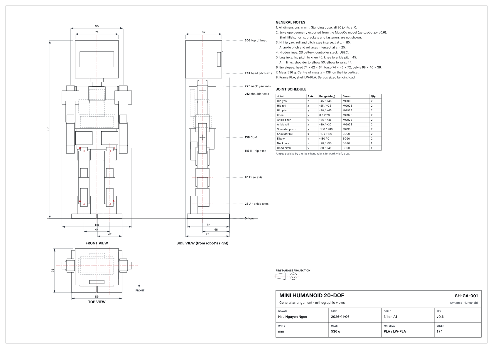

| File | Artboard |
| --- | --- |
| `A2_Mico.dc.html` | **Main shell** · Mico v2.0 |
| `Mico_Views.dc.html` | Mico side, rear and foot underside (FSR pads) |
| `Mico_Faces.dc.html` | Mico expression set on the OLED |
| `Main.dc.html` | A1 · Hero front view, with part sizes and joint heights |
| `A3_Pico.dc.html`, `A4_Luno.dc.html`, `A5_Kiko.dc.html` | Hero family variants |
| `ShellB.dc.html` | Shell B (villain) armor, front and side |
| `Side.dc.html` | Side view with depths, internal layout and CoM (146 mm) |
| `Joints.dc.html` | 20-joint map, colored by servo (DS843MG / MG90S / SG90) |
| `BOM.dc.html` | Bill of materials v0.7, cheapest HCMC prices (Nov 2026), about 5.65M VND |
| `Drawing.dc.html` | GA drawing, first-angle projection (front, side, top), A1 at 1:1 |
| `canvas.json` | Canvas layout |
| `images/*.png` | Rendered exports of the three artboards |

The `.dc.html` files render inside Claude Design (they load its `support.js`); the SVG
inside each file is plain and can be copied out on its own.
